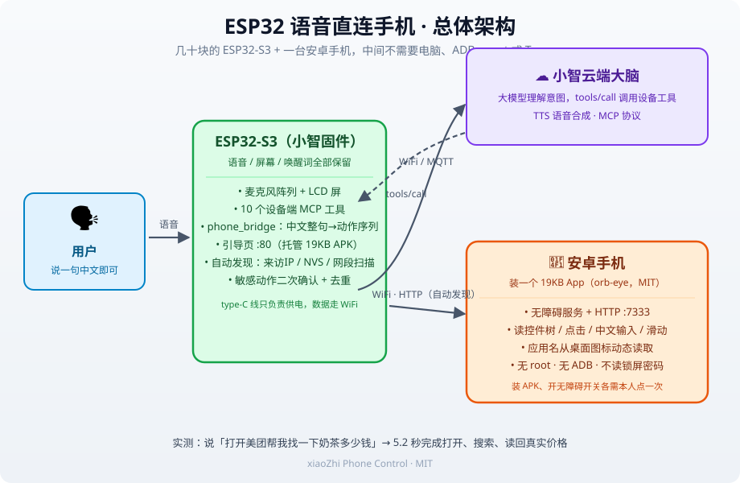
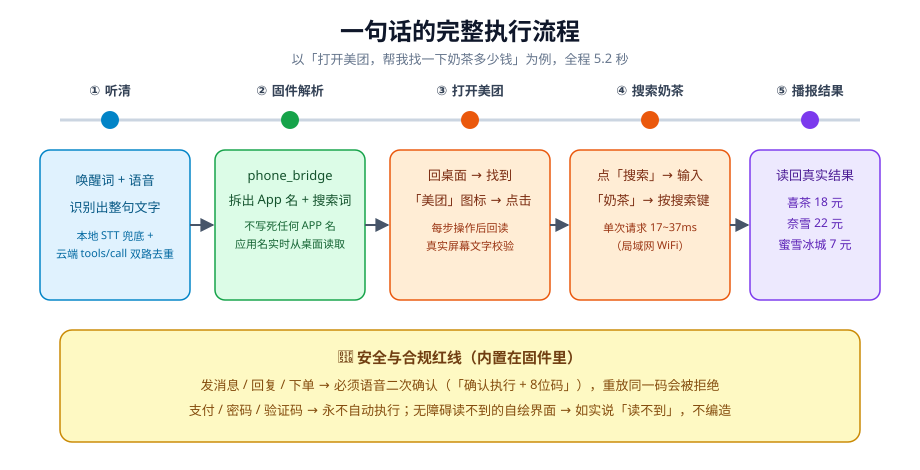

# xiaozhi-phone-control

**ESP32 语音直连控制安卓手机** —— 几十块的 ESP32-S3 + 一台手机，中间不需要电脑。

对着小智说「打开美团，帮我找一下奶茶多少钱」，ESP32 自己解析整句、操控手机上的美团、
搜索奶茶、把屏幕上的真实价格读回来念给你听 —— 全程 5.2 秒。


## 它是怎么工作的



- **ESP32-S3** 烧录小智固件（语音、屏幕、唤醒词、云端大脑全部保留），新增 `phone_bridge`：
  中文整句 → 动作序列 → 每步回读真实屏幕。
- **手机端** 只装一个 19KB 的 App（[orb-eye](https://github.com/EatTake/orb-eye)，MIT 协议）：
  一个无障碍服务 + 手机内置 HTTP 服务。**不需要 ADB、不需要 root、不需要 Termux、不需要电脑。**
- 那根 type-C 线只负责供电。数据走 WiFi：小智大脑本来就在云端；而且 Android 不允许外部 USB
  配件读屏或注入操作，这块板的 USB 引脚还与屏幕复用（实测开 USB 直接黑屏）。
- **自动发现**：手机连上同一 WiFi、浏览器打开 ESP32 引导页之后，ESP32 自己记住手机地址
  （引导页来访 IP → NVS 记忆 → 同网段扫描三重保障），换手机、换路由器都不用手填 IP。

一句话的完整执行流程：



## 核心特性

| 能力 | 说明 |
|---|---|
| 🗣️ 整句自然语言 | 「打开手机上的美团，搜一下奶茶多少钱」「读一下手机屏幕」「按回车」「上滑」 |
| 📱 动态读 APP | 应用列表实时从手机桌面图标读取中文名，**不写死任何包名映射**，换手机自动适应 |
| 👀 真实读屏 | 基于无障碍控件树回读屏幕文字，看到什么说什么，不编造价格、不伪造「已发送」 |
| ✍️ 中文输入 | `ACTION_SET_TEXT` 直接写输入框，无需第三方输入法 |
| 🔐 敏感动作二次确认 | 发消息 / 回复 / 下单必须再说「确认执行 + 8位码」，重放同一码会被拒绝 |
| 🚫 合规红线 | 支付、密码、验证码永不自动执行；不提供任何绕过平台风控的能力 |
| 🖥️ 10 个 MCP 工具 | `self.phone.control` 等工具走小智原生语音通道上报，云端大模型可直接调用 |
| 🔁 双链路 | 手机离线超 20 秒自动回退「语音控制电脑」链路（`macset` 切换，见下文） |

## 快速开始

### 1. 烧录固件（二选一）

```bash
# 方式 A：直接烧预编译固件（最快）
pip install esptool
cd tools && ./flash_prebuilt.sh /dev/cu.usbserial-XXXX

# 方式 B：从源码构建（需要 ESP-IDF v6.1）
git clone https://github.com/78/xiaozhi-esp32.git ~/esp/xiaozhi-esp32
cd firmware && ./apply.sh ~/esp/xiaozhi-esp32
# 然后按 firmware/BUILD.md 编译烧录
```

烧完串口（115200）会打印：`手机接入引导页: http://192.168.x.x/`

### 2. 手机接入（约 2 分钟，只做一次）

1. 手机连上与 ESP32 **同一个 WiFi**
2. 浏览器打开引导页 → 点击下载 19KB App → 安装
3. 设置 → 无障碍 → 打开 Orb Eye 开关
4. 回到引导页看到绿色「已连接」—— ESP32 已经自动记住手机，之后不用再管

> 装应用和开无障碍开关这两步 Android 强制要求本人操作，这是系统安全边界，本项目不提供也不应该提供绕过方式。

### 3. 开口说话

对 ESP32 上的小智直接说：

> 「打开手机上的美团，帮我找一下奶茶多少钱」
> 「手机屏幕上现在显示什么」
> 「用手机上的微信给张三发消息说明天见」 → 会先要确认码，再说「确认执行 38f2a1c9」才真正发送
> 「打开手机上的 QQ音乐，播放世上只有妈妈好」

没有手机在旁边？串口自测命令同样走完整链路：`macphone 打开美团找一下奶茶多少钱`

## 仓库结构

```
├── docs/
│   ├── ESP32_DIRECT.md        # 完整设计文档（架构、协议、边界、排错）
│   └── images/                # 架构图 / 流程图 / 主视觉
├── firmware/                  # 对 xiaozhi-esp32 上游的完整改动
│   ├── board/                 # 板级源码（phone_bridge 等，见 BUILD.md）
│   ├── patches/               # 上游非板级文件补丁
│   ├── sdkconfig.board        # 可复现的完整 sdkconfig
│   ├── apply.sh               # 一键应用
│   └── BUILD.md               # 构建 / 烧录 / 串口命令 / 踩坑记录
├── prebuilt/                  # 预编译固件（bootloader/分区表/otadata/app/assets）
└── tools/
    ├── phone_apk/             # orb-eye APK + 无障碍服务源码（MIT）
    ├── mock_orb_eye.py        # 模拟一台手机，无需真机即可端到端自测
    ├── mock_adb.py            # 模拟手机（ADB 通道）
    ├── computer_portal.py     # 可选的「语音控制电脑」Portal（Mac/Linux）
    ├── android_adb.py / ax_ui.py / browser_cdp.py   # Portal 的三个执行后端
    ├── ADBKeyboard.apk        # ADB 通道的中文输入法（可选链路用）
    ├── flash_prebuilt.sh      # 预编译固件烧录脚本
    └── start_computer_portal.sh  # 电脑 Portal 启动脚本（可选链路用）
```

## 无需真机的自测

```bash
python3 tools/mock_orb_eye.py 7333 &     # 模拟一台已装好 App 的手机
# ESP32 串口执行：phonebind <运行 mock 的机器IP>，随后
# ESP32 串口执行：macphone 打开美团帮我找一下奶茶多少钱
# → 约 5 秒后读回：喜茶 18 元 / 奈雪 22 元 / 蜜雪冰城 7 元
```

## 可选链路：语音控制电脑

同一套 10 个 MCP 工具也支持控制电脑（打开 App、真实读屏、微信发消息、QQ音乐点歌、
CDP 控制浏览器），在电脑上运行：

```bash
cd tools && ./start_computer_portal.sh 8080 mytoken
# ESP32 串口执行：macset <电脑IP>:8080 mytoken
```

手机离线超过 20 秒，固件也会自动回退到这条链路。

## 为什么不用蓝牙 / USB 直连？

早期版本都试过，都实测过：

- **BLE HID**：Android 上只注入按键流，拿不到屏幕内容和 APP 状态，等于盲按；
  且与语音链路抢内存（稳态只剩 ~7KB，聆听时直接 ENOMEM）。
- **USB HID**：这块板的原生 USB D-/D+ 是 GPIO19/20，与 LCD 复用，开 USB 立刻黑屏；
  Android 也不给 USB 配件读屏权限。
- 结论：**读得到屏幕才谈得上控制**，所以最终方案是 WiFi + 无障碍服务。

详见 `docs/ESP32_DIRECT.md` 的完整推演过程。

## 安全须知

- orb-eye 的 HTTP 服务绑定 `0.0.0.0` 且无鉴权，**请只在可信 WiFi 使用**，
  不要把手机端口暴露到公网。
- 发消息、回复、下单必须二次确认；支付/密码/验证码永不自动执行。
- 部分金融类 App 检测到无障碍服务会限制功能——这是平台策略，本项目不绕过。
- iPhone 非越狱没有等价通道，本方案只覆盖 Android。

## 致谢与许可

- [78/xiaozhi-esp32](https://github.com/78/xiaozhi-esp32) — 小智 AI 语音助手（MIT）
- [EatTake/orb-eye](https://github.com/EatTake/orb-eye) — Android 无障碍 HTTP 服务（MIT）
- [senzhk/ADBKeyBoard](https://github.com/senzhk/ADBKeyBoard) — ADB 中文输入法（Apache-2.0，可选链路使用）

本项目代码以 **MIT** 协议开源，见 [LICENSE](LICENSE)。
